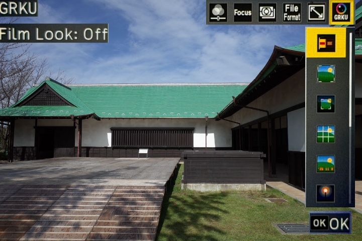

# GRKU.

**GR 의 당신, 원하는 스타일로** — SD 카드로 즐기는 RICOH GR III, GR IIIx, GR IV를 위한 필름 룩입니다. 펌웨어에는 아무것도 쓰지 않습니다. 카메라는 카드의 스크립트를 실행할 뿐이며, 카드를 빼면 카메라는 Ricoh가 출하한 원래 상태로 돌아갑니다.

[ไทย](README.th.md) | [English](README.md) | [简体中文](README.zh-Hans.md) | [繁體中文](README.zh-Hant.md) | [日本語](README.ja.md) | 한국어

[](https://github.com/botnick/GRKU/actions/workflows/tests.yml)
[](LICENSE)
[](https://grku.app)

GRKU는 태국의 GR 사용자를 우선으로, 이어서 전 세계 사용자를 위해 [BOTNICK](https://github.com/botnick)이 제작한 독립 프로젝트입니다. 실제 필름 박스 아이콘이 포함된 152개 필름 룩 라이브러리, 레시피, 추가 모듈, 원샷 시작, 카드 쓰기와 추가 룩 판매를 지원하는 웹, 태국어 음성, 자체 릴리스 파이프라인을 갖추고 있습니다. 사용 설명서는 [grku.app/docs](https://grku.app/docs/)에서 확인할 수 있습니다.

<p>
  
  
</p>

사진: [Mobnoboka](https://commons.wikimedia.org/wiki/File:Oguchi_Joushi_Kouen_1.jpg), [CC BY-SA 4.0](https://creativecommons.org/licenses/by-sa/4.0/).

## 기능

촬영 중 ADJ 레버를 누르고 여섯 번째 항목인 GRKU를 선택합니다. GRKU의 모든 기능은 여기에 있으며, MENU의 GRKU 섹션에도 있습니다. 카메라를 껐다 켠 후에도 ADJ는 이전에 머물렀던 항목의 GRKU에서 다시 열립니다.

- **Film Look**: 실제 필름의 152가지 룩으로, 한 번에 40가지가 카드에 들어갑니다. Kodak, Fujifilm, Ilford, CineStill, Lomography, Polaroid, Agfa, Harman, Rollei와 함께 GR II의 Positive Film을 본뜬 GRKU 고유의 룩인 GR II Positive (GRKU), 그리고 Provia와 Classic Chrome부터 Acros까지 무료로 제공되는 FUJIFILM 카메라의 10가지 필름 시뮬레이션이 있습니다. 각 룩에는 실제 상자의 색상으로 된 필름 상자 아이콘이 있습니다. Fn 버튼으로 룩을 조절할 수 있으며, 사이트에서 직접 만든 LUT를 가져올 수도 있습니다.
- **Recipes**: 카메라의 전체 룩을 이름으로 저장하거나 사이트에서 인기 있는 레시피를 가져온 다음, Film Look 또는 Image Control, 그레인, 글로우, 화이트 밸런스, 보정 및 노출을 한 번에 전환할 수 있으며 실행 취소도 지원합니다.
- **Framing**: XPan, 2.35:1, 16:9, 4:3, 5:4, 7:6, 1:1, 3:4로, JPEG 사진을 크롭하거나 프레임 라인으로만 표시합니다. **Crop**: 35, 40, 50 또는 70 mm를 라이브 뷰와 함께 제공합니다.
- **Guides**: 삼등분, 중앙, 황금비, 대각선, 황금 나선, 다이내믹 시머트리.
- **Date Imprint**: 클래식, GR1s 도트 매트릭스, 또는 GR II 스타일로 사진에 날짜를 인쇄합니다.
- **Glow**: 조명과 하이라이트 주변의 Bloom, 영화 필름 색상의 적주황색 후광인 Halation.
- **Light Leak**: 비네트, 먼지와 머리카락, 라이트 리크, 스크래치, 또는 Faded, Dusty, Leaky, Expired 프리셋. 매 촬영마다 다르게 나타납니다.
- **Diffusion**: 1/8, 1/4, 1/2 강도의 Black Pro-Mist 필터, 섀도 위의 Black Mist 베일, 점 광원의 아나모픽 스트릭. 또한 단독으로 사용할 수 있는 필름 부드러움(약, 중, 강)은 필름 스캔 특유의 은은한 부드러움을 표현합니다.
- **그레인**: 4단계 강도와 4단계 크기. 카메라 기본 표현 또는 필름형(인화지 위 컬러 네거티브 그레인, Andrea Volpato의 [spektrafilm](https://github.com/andreavolpato/spektrafilm) 그레인 모델 기반, piratenpanda 제작).
- **Border**: 사진 전체에 얇게, 넓게 또는 인스턴트 스타일의 흰색/검은색 테두리를 적용합니다. 원본 픽셀을 그대로 유지한 채 테두리만큼 JPEG 크기가 확장됩니다.
- **Enable at Start**: 전원을 켤 때마다 GRKU를 켜짐, 꺼짐, 또는 마지막 상태 그대로 유지.
- **Distance Unit**: MENU의 GRKU Settings에서 스냅 초점 거리 및 수동 초점 눈금을 미터(m) 또는 피트(ft)로 설정할 수 있습니다.

GRKU는 전원을 켠 후 약 9초 후에 나타납니다(설치 후 첫 시작 시에는 더 오래 걸립니다). 그 전까지 카메라는 원래 상태로 작동합니다. 설정한 모든 내용은 카드의 `GRKU` 폴더에 유지됩니다.

## 지원 카메라

| Camera | Ran on a camera | Built for |
| --- | --- | --- |
| GR III, GR III HDF | — | 2.10, 2.20, 2.21 |
| GR IIIx, GR IIIx HDF | — | 1.60, 1.70, 1.71 |
| GR IV, GR IV HDF | 1.11 | 1.11, 1.20, 1.21 |
| GR IV Monochrome | — | 1.00, 1.10, 1.11 |

GRKU 자체 변경 사항은 펌웨어 1.11이 설치된 GR IV에서 실행 확인되었습니다. GR III 및 GR IIIx 패키지는 동일한 코드와 테스트로 빌드되었으나 아직 실제 카메라에서 실행된 사례는 없습니다. 직접 실행해 보셨다면 작동 여부를 [이슈](https://github.com/botnick/GRKU/issues)로 알려주십시오. 2026년 11월 10일 Ricoh가 배포한 펌웨어(GR III 2.21, GR IIIx 1.71, GR IV 1.21, GR IV Monochrome 1.11)용 빌드는 Ricoh 펌웨어 파일과 대조 검증을 마쳤으며 아직 카메라에서 실행해 보지는 않았습니다.

> [!WARNING]
> GRKU는 실험적인 프로젝트입니다. 사용에 따른 책임은 본인에게 있습니다.
> 설치하면 카메라의 SD 스크립트 설정이 켜지고, 끌 때까지 그대로 유지됩니다. GRKU에 문제가 발생하면 카메라가 시작 중에 멈출 수 있습니다. 먼저 [복구 가이드](resources/RECOVERY.md)를 읽어 주십시오.

## 설치

[grku.app](https://grku.app)으로 이동하여 카메라, 모듈, 필름 룩을 선택한 다음 아래 방법 중 하나를 진행합니다.

- Chrome이나 Edge에서 **SD 카드에 기록**합니다(사이트에서 업데이트, 룩 추가 및 삭제, 제거도 가능합니다). 또는
- **ZIP 다운로드**(`GRKU-gr3.zip`, `GRKU-gr3x.zip` 또는 `GRKU-gr4.zip`)를 하고 안에 들어 있는 PDF 가이드를 따릅니다([GR III 및 GR IIIx](resources/INSTALLATION.md), [GR IV](resources/INSTALLATION-GR4.md)).

처음 한 번만 MENU를 누른 채 전원을 켭니다. ZIP으로 업데이트할 때는 카드의 `SCRIPT` 폴더를 교체합니다. 설정은 `GRKU`에 유지됩니다. 카드를 포맷하면 GRKU가 제거됩니다.

`GRKIT` 폴더가 있는 이전 카드에서 옮겨오는 경우: 웹사이트가 설정과 룩을 `GRKU`로 옮겨 줍니다. 파일을 직접 복사한다면 첫 실행 전에 카드 루트의 `GRKIT` 이름을 `GRKU`로 바꾸거나 삭제하십시오.

GRKU가 나타나지 않으면 `GRKU/REPORT.TXT`, `GRKU/BOOT.TXT`, `SCRIPT/GRKU/INSTALL.ERR`(있는 경우)을 첨부하여 [이슈](https://github.com/botnick/GRKU/issues/new)를 등록해 주십시오. [각 줄의 의미](docs/diagnostics.md)를 참고하십시오.

## GRKU Plus

무료 사이트에서는 10개의 룩을 카드에 기록할 수 있습니다. GRKU Plus는 PromptPay를 통한 일회성 결제로 25개의 슬롯, 브랜드 팩, 또는 모든 기능(40개 슬롯 및 모든 룩)을 잠금 해제합니다. 키는 이메일로 전송되며 모든 기기에서 작동합니다. 이 서비스는 `services/plus`에서 실행되며 카드를 직접 보지 않습니다.

## 소스에서 빌드

Rust 1.92 이상, ARM을 지원하는 Clang과 LLD, 리코 공식 펌웨어 파일이 필요합니다(펌웨어는 저장소에 들어 있지 않습니다).

```sh
cargo install --path crates/grku-cli --locked
grku effects build --source effects --out build/effects
grku build --target gr4-1.11 --firmware firmware/fwdc248b.bin --out build/runtime
for module in modules/*/; do grku module build --dir "$module" --out "build/modules/$(basename "$module").GRM"; done
sh .github/scripts/install-guide-tools.sh build/guide-tools
sh .github/scripts/build-guides.sh grku build/guide-tools build/guides
grku package --build build/runtime --camera gr4 --effects build/effects-default \
  $(for m in build/modules/*.GRM; do case $m in *BORDER*) ;; *) printf -- '--module %s ' "$m";; esac; done) \
  --guide build/guides/gr4/en.pdf --out dist/GRKU-gr4.zip
grku verify dist/GRKU-gr4.zip
```

`build/effects`에는 152개의 룩이 모두 들어갑니다. 패키지에는 최대 40개까지만 담을 수 있으므로 `python3 -I scripts/defaults.py build/effects build/effects-default`로 `effects/defaults.txt`의 40개를 고릅니다. 패키지에는 모듈을 10개까지 담을 수 있으므로 하나를 제외해야 합니다(릴리스에서는 Border를 제외합니다). GR III의 경우 각 펌웨어의 `fwdc239b.bin`에서 `gr3-2.10`과 `gr3-2.21`을 빌드하고, `--camera gr3` 및 각각에 대한 `--build`로 패키징합니다. GR IV 패키지는 `gr4-1.11`, `gr4-1.20`, `gr4-1.21`을 받습니다. 그런 다음 `python3 -I scripts/card.py write dist/GRKU-gr4.zip`을 실행하면 카드 리더기에 있는 카드에 패키지가 기록됩니다.

## 기여하기

[CONTRIBUTING.md](CONTRIBUTING.md)를 참조하십시오. 기기 보고는 보내주실 수 있는 가장 유용한 피드백이며, 특히 GR III 또는 GR IIIx의 보고를 환영합니다. 문제, 아이디어 및 질문은 [이슈](https://github.com/botnick/GRKU/issues)로 보내 주십시오.

## 문서

- [아키텍처](docs/architecture.md)와 [원샷 시작](docs/one-shot-start.md)
- [모듈 작성하기](docs/modules.md)와 [모듈 레퍼런스](docs/module-reference.md)
- [기기 리포트](docs/diagnostics.md): `BOOT.TXT`, `REPORT.TXT`, `INSTALL.ERR`를 한 줄씩 설명
- [효과](effects/README.md), [LUT 소스](docs/lut-sources.md) 및 [2026년 인기 필름](docs/popular-films-2026.md)
- [웹사이트](web/README.md), [브랜드](docs/brand.md) 및 [제품 노트](docs/PRODUCT.md)
- [로드맵](docs/roadmap.md), [커뮤니티 설문조사](docs/community-survey.md) 및 [인수인계 노트](HANDOFF.md)
- grku.app의 [릴리스 안내](docs/releasing.md) 및 [사용 설명서](https://grku.app/docs/)

## 라이선스

코드는 [MIT 라이선스](LICENSE)입니다. GRKU에는 ahonn의 [GRKit](https://github.com/ahonn/GRKit) 코드가 포함되어 있으며, 마찬가지로 MIT 라이선스이고 그 고지 사항을 그대로 유지합니다. 각 패키지에는 포함된 파일의 라이선스를 정리한 `LICENSES.md`가 들어 있습니다.

- 효과의 라이선스는 CC BY-SA 4.0, MIT 또는 Apache-2.0입니다. [effects/NOTICE.md](effects/NOTICE.md)를 참고하십시오.
- 메뉴와 라이브 뷰의 텍스트에는 [Roboto Condensed](https://github.com/googlefonts/roboto-classic)를 [SIL Open Font License 1.1](crates/grku-core/assets/RobotoCondensed-LICENSE.txt)에 따라 사용합니다.
- 효과 피팅은 [gr3-film-mods](https://github.com/idontknownihil/gr3-film-mods)에서 [MIT 라이선스](crates/grku-core/GR3_FILM_MODS_LICENSE.txt)에 따라 이식되었습니다.

RICOH 및 GR은 Ricoh Company, Ltd.의 상표입니다. 필름 명칭은 각 소유자의 상표입니다. GRKU는 [BOTNICK](https://github.com/botnick)이 진행하는 독립 프로젝트이며 Ricoh 또는 필름 제조사와 제휴 관계가 없습니다.
