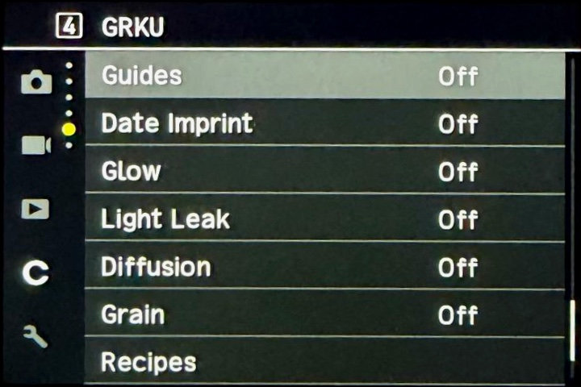

# GRKU.

**GR ของคุณ ในแบบที่ชอบ** — ฟิล์มลุคสำหรับ RICOH GR III, GR IIIx และ GR IV จากการ์ด SD โดยไม่มีการแฟลชข้อมูลใดๆ: กล้องจะรันสคริปต์จากการ์ด และเมื่อไม่มีการ์ด กล้องก็คือตัวเดิมที่ Ricoh ส่งมอบมา

ไทย | [English](README.md) | [简体中文](README.zh-Hans.md) | [繁體中文](README.zh-Hant.md) | [日本語](README.ja.md) | [한국어](README.ko.md)

[](https://github.com/botnick/GRKU/actions/workflows/tests.yml)
[](LICENSE)
[](https://grku.app)

GRKU เป็นโปรเจกต์แยกต่างหากที่สร้างโดย [BOTNICK](https://github.com/botnick) สำหรับคนใช้ GR ในไทยก่อน แล้วค่อยขยายไปที่อื่น มีคลังฟิล์ม 152 ลุคพร้อมไอคอนกล่องฟิล์มจริง สูตรสี โมดูลเพิ่มเติม เปิดใช้งานครั้งเดียว เว็บที่เขียนลงการ์ดและขายลุคเพิ่ม เสียงภาษาไทย และระบบออกเวอร์ชันของตัวเอง คู่มืออยู่ที่ [grku.app/docs](https://grku.app/docs/)

<p>
  
  
</p>

ภาพถ่ายบนหน้าจอโดย: [Mobnoboka](https://commons.wikimedia.org/wiki/File:Oguchi_Joushi_Kouen_1.jpg), [CC BY-SA 4.0](https://creativecommons.org/licenses/by-sa/4.0/)

## ฟีเจอร์

กดปุ่ม ADJ ขณะถ่ายภาพแล้วเลือกรายการที่ 6 คือ GRKU การทำงานทั้งหมดของ GRKU จะรวมอยู่ในนั้น และในส่วนของ GRKU ใน MENU ปุ่ม ADJ จะเปิดกลับมาที่ GRKU อีกครั้งตรงแถวเดิมที่คุณค้างไว้ แม้หลังจากปิดกล้องไปแล้วก็ตาม

- **Film Look**: 152 ลุคจากฟิล์มจริง ใส่ในการ์ดได้ครั้งละ 40 ลุค ได้แก่ Kodak, Fujifilm, Ilford, CineStill, Lomography, Polaroid, Agfa, Harman และ Rollei รวมทั้ง Positive GRII ซึ่งเป็นลุคเฉพาะของ GRKU ตามแบบฟิล์ม Positive ของ GR II และฟิล์มซิมูเลชัน 10 แบบของกล้อง FUJIFILM ตั้งแต่ Provia และ Classic Chrome ไปจนถึง Acros ซึ่งเปิดให้ใช้ได้ฟรี แต่ละลุคมีไอคอนกล่องฟิล์มตามสีของกล่องจริง กดปุ่ม Fn เพื่อปรับแต่งลุค นำเข้าไฟล์ LUT ของตัวเองได้ที่เว็บไซต์
- **Recipes**: บันทึกโทนภาพทั้งหมดของกล้องไว้ในชื่อเดียว หรือดึงสูตรยอดนิยมมาจากเว็บไซต์ จากนั้นสลับเปลี่ยน Film Look หรือ Image Control, เกรน, แสงฟุ้ง (Glow), ไวต์บาลานซ์, การชดเชยต่างๆ และค่าแสงได้ในขั้นตอนเดียว พร้อมฟังก์ชัน Undo
- **Framing**: XPan, 2.35:1, 16:9, 4:3, 5:4, 7:6, 1:1 และ 3:4 เลือกได้ทั้งแบบครอปภาพ JPEG หรือแสดงเฉพาะเส้นกรอบ **Crop**: 35, 40, 50 หรือ 70 มม. พร้อมพรีวิวในไลฟ์วิว
- **Guides**: เส้นจุดตัดเก้าช่อง จุดกึ่งกลาง สัดส่วนทองคำ เส้นทแยงมุม วงก้นหอยทองคำ สมมาตรไดนามิก
- **Date Imprint**: พิมพ์วันที่ลงบนภาพในสไตล์คลาสสิก ดอตเมทริกซ์แบบ GR1s หรือสไตล์ GR II
- **Glow**: Bloom รอบดวงไฟและส่วนไฮไลต์ Halation ขอบแสงสีส้มแดงตามโทนสีของฟิล์มภาพยนตร์
- **Light Leak**: ขอบมืด ฝุ่นและเส้นขน แสงรั่ว รอยขีดข่วน หรือเลือกจากพรีเซ็ต Faded, Dusty, Leaky และ Expired แตกต่างกันไปในแต่ละช็อต
- **Diffusion**: ฟิลเตอร์ Black Pro-Mist ที่ระดับ 1/8, 1/4 หรือ 1/2 ม่านแสง Black Mist ทับส่วนเงามืด และแสงแฟลร์แนวนอนแบบเลนส์ Anamorphic จากจุดกำเนิดแสง รวมถึงความนุ่มแบบฟิล์ม (ต่ำ ปานกลาง สูง) ที่ให้ความนุ่มนวลแบบเดียวกับการสแกนฟิล์ม
- **Grain**: ปรับได้ 4 ระดับความแรง 4 ขนาด ทั้งแบบที่กล้องสร้างให้หรือแบบ Film-like ที่เป็นเกรนของฟิล์มเนกาทีฟสีบนกระดาษ ตามโมเดลเกรนของ [spektrafilm](https://github.com/andreavolpato/spektrafilm) โดย Andrea Volpato (โดย piratenpanda)
- **Border**: ใส่กรอบสีขาวหรือสีดำรอบภาพ ทั้งแบบ Thin, Wide หรือ Instant โดยไฟล์ JPEG จะขยายตามขนาดกรอบและคงภาพไว้ครบทุกพิกเซล
- **Enable at Start**: กำหนดให้ GRKU เปิด ปิด หรือคงสถานะเดิมตามที่ตั้งทิ้งไว้ ทุกครั้งที่เปิดกล้อง
- **Distance Unit**: เลือกระยะ Snap focus และสเกลโฟกัสแบบหมุนเองเป็นเมตรหรือฟุตได้ใน MENU ภายใต้ GRKU Settings

GRKU จะแสดงขึ้นมาหลังจากเปิดกล้องประมาณ 9 วินาที (และจะนานขึ้นในการเปิดเครื่องครั้งแรกหลังการติดตั้ง) ระหว่างนั้นกล้องจะทำงานตามปกติของตัวกล้อง ทุกการตั้งค่าของคุณจะถูกเก็บไว้ในโฟลเดอร์ `GRKU` บนการ์ด

## กล้องที่รองรับ

| กล้อง | ทดสอบกับกล้องจริงแล้ว | รองรับ |
| --- | --- | --- |
| GR III, GR III HDF | — | 2.10, 2.20, 2.21 |
| GR IIIx, GR IIIx HDF | — | 1.60, 1.70, 1.71 |
| GR IV, GR IV HDF | 1.11 | 1.11, 1.20, 1.21 |
| GR IV Monochrome | — | 1.00, 1.10, 1.11 |

ส่วนที่ GRKU ปรับแต่งเองทดสอบรันบน GR IV เฟิร์มแวร์ 1.11 แล้ว ส่วนแพ็กเกจของ GR III และ GR IIIx สร้างจากโค้ดและชุดทดสอบเดียวกัน แต่ยังไม่มีใครลองรัน GRKU บนกล้องรุ่นเหล่านั้น ถ้าได้ลองแล้วช่วยบอกผลใน [issue](https://github.com/botnick/GRKU/issues) ว่าใช้งานได้หรือเปล่า ส่วนบิลด์สำหรับเฟิร์มแวร์ที่ Ricoh ปล่อยเมื่อ 10 พฤศจิกายน 2026 (GR III 2.21, GR IIIx 1.71, GR IV 1.21, GR IV Monochrome 1.11) ได้ตรวจสอบเทียบกับไฟล์เฟิร์มแวร์ของ Ricoh แล้ว แต่ยังไม่ได้ลองรันบนกล้องจริง

> [!WARNING]
> GRKU ยังอยู่ในขั้นทดลอง ผู้ใช้ต้องรับความเสี่ยงด้วยตัวเอง
> การติดตั้งจะเปิดตั้งค่าสคริปต์การ์ด SD ของกล้อง ซึ่งจะเปิดค้างไว้จนกว่าคุณจะสั่งปิด หาก GRKU ทำงานผิดพลาด กล้องอาจค้างตอนเปิดเครื่องได้ ควรอ่าน[คู่มือกู้คืนระบบ](resources/RECOVERY.md)ก่อน

## การติดตั้ง

ไปที่ [grku.app](https://grku.app) เลือกรุ่นกล้อง โมดูล และฟิล์มลุคของคุณ จากนั้นเลือกทำอย่างใดอย่างหนึ่งต่อไปนี้

- **เขียนลงการ์ด SD** ผ่าน Chrome หรือ Edge (นอกจากนี้เว็บไซต์ยังสามารถอัปเดต เพิ่มหรือลบลุค และถอนการติดตั้งได้ด้วย) หรือ
- **ดาวน์โหลดไฟล์ ZIP** (`GRKU-gr3.zip`, `GRKU-gr3x.zip` หรือ `GRKU-gr4.zip`) แล้วทำตามคู่มือ PDF ที่อยู่ในไฟล์ ([GR III และ GR IIIx](resources/INSTALLATION.md), [GR IV](resources/INSTALLATION-GR4.md))

เฉพาะการใช้งานครั้งแรก ให้กดปุ่ม MENU ค้างไว้ขณะเปิดกล้อง หากต้องการอัปเดตจากไฟล์ ZIP ให้เขียนทับโฟลเดอร์ `SCRIPT` บนการ์ด การตั้งค่าของคุณจะยังคงอยู่ใน `GRKU` การฟอร์แมตการ์ดจะทำให้ GRKU ถูกลบออก

ถ้ามาจาก การ์ดใบเก่าที่มีโฟลเดอร์ `GRKIT` เว็บจะย้ายการตั้งค่าและลุคจากโฟลเดอร์นั้นไปไว้ที่ `GRKU` ให้ ถ้าก๊อปปี้ไฟล์เอง ให้เปลี่ยนชื่อ `GRKIT` เป็น `GRKU` ที่โฟลเดอร์หลักของการ์ดก่อนเปิดใช้งานครั้งแรก หรือลบออก

หาก GRKU ไม่แสดงขึ้นมา ให้ส่งไฟล์ `GRKU/REPORT.TXT`, `GRKU/BOOT.TXT` และ `SCRIPT/GRKU/INSTALL.ERR` (ถ้ามี) เข้ามาใน [issue](https://github.com/botnick/GRKU/issues/new) [ความหมายของแต่ละบรรทัด](docs/diagnostics.md)

## GRKU Plus

เว็บไซต์ฟรีสามารถเขียนได้ 10 ลุคใดๆ ลงในการ์ด GRKU Plus คือการชำระเงินครั้งเดียวผ่านพร้อมเพย์ (PromptPay) ซึ่งจะปลดล็อกช่องใส่ 25 ช่อง, ชุดฟิล์มตามแบรนด์ (brand pack) หรือทั้งหมด (40 ช่องและทุกลุค) คีย์จะส่งให้ทางอีเมลและใช้งานได้บนทุกอุปกรณ์ บริการนี้ทำงานอยู่ใน `services/plus` โดยจะไม่มีการเข้าถึงการ์ดของคุณเลย

## การบิลด์จากซอร์สโค้ด

คุณต้องมี Rust 1.92 หรือใหม่กว่า, Clang และ LLD ที่รองรับ ARM รวมถึงไฟล์เฟิร์มแวร์ทางการของ Ricoh ซึ่งไม่ได้รวมอยู่ในรีโพซิทอรีนี้

```sh
cargo install --path crates/grku-cli --locked
grku effects build --source effects --out build/effects
grku build --target gr4-1.11 --firmware firmware/fwdc248b.bin --out build/runtime
for module in modules/*/; do grku module build --dir "$module" --out "build/modules/$(basename "$module").GRM"; done
sh .github/scripts/install-guide-tools.sh build/guide-tools
sh .github/scripts/build-guides.sh grku build/guide-tools build/guides
grku package --build build/runtime --camera gr4 --effects build/effects-default \
  $(for m in build/modules/*.GRM; do case $m in *BORDER*) ;; *) printf -- '--module %s ' "$m";; esac; done) \
  --guide build/guides/gr4/en.pdf --out dist/GRKU-gr4.zip
grku verify dist/GRKU-gr4.zip
```

`build/effects` จะเก็บลุคทั้งหมด 152 ลุคไว้ แพ็กเกจหนึ่งใส่ได้สูงสุด 40 ลุค ดังนั้น `python3 -I scripts/defaults.py build/effects build/effects-default` จึงใช้เลือก 40 ลุคจาก `effects/defaults.txt` แพ็กเกจหนึ่งจุได้สิบโมดูล จึงต้องเว้นไว้หนึ่งโมดูล (เวอร์ชันเผยแพร่ได้เว้น Border เอาไว้) สำหรับ GR III ให้บิลด์ `gr3-2.10` และ `gr3-2.21` โดยแต่ละตัวบิลด์มาจาก `fwdc239b.bin` ของเฟิร์มแวร์รุ่นนั้นๆ แล้วแพ็กเกจด้วย `--camera gr3` พร้อมทั้งระบุ `--build` สำหรับแต่ละตัว ส่วนแพ็กเกจของ GR IV จะใช้ `gr4-1.11`, `gr4-1.20` และ `gr4-1.21` จากนั้นคำสั่ง `python3 -I scripts/card.py write dist/GRKU-gr4.zip` จะเขียนแพ็กเกจลงในการ์ดที่อยู่ในเครื่องอ่านการ์ด

## การมีส่วนร่วม

ดูรายละเอียดได้ที่ [CONTRIBUTING.md](CONTRIBUTING.md) รายงานผลการใช้งานจากตัวกล้องคือสิ่งที่มีประโยชน์ที่สุดที่คุณส่งมาได้ โดยเฉพาะจากรุ่น GR III หรือ GR IIIx ส่งปัญหาที่พบ ไอเดีย และคำถามเข้ามาได้ที่ [issues](https://github.com/botnick/GRKU/issues)

## เอกสารประกอบ

- [สถาปัตยกรรม](docs/architecture.md) และ[การเริ่มต้นแบบรวดเดียว](docs/one-shot-start.md)
- [การเขียนโมดูล](docs/modules.md) และ[ข้อมูลอ้างอิงโมดูล](docs/module-reference.md)
- [รายงานอุปกรณ์](docs/diagnostics.md): `BOOT.TXT`, `REPORT.TXT` และ `INSTALL.ERR` ทีละบรรทัด
- [เอฟเฟกต์](effects/README.md), [แหล่งที่มาของ LUT](docs/lut-sources.md) และ[ฟิล์มยอดนิยมแห่งปี 2026](docs/popular-films-2026.md)
- [เว็บไซต์](web/README.md), [แบรนด์](docs/brand.md) และ[บันทึกผลิตภัณฑ์](docs/PRODUCT.md)
- [แผนงาน](docs/roadmap.md), [แบบสำรวจความคิดเห็นชุมชน](docs/community-survey.md) และ[บันทึกการส่งต่องาน](HANDOFF.md)
- [Releasing](docs/releasing.md) และ [คู่มือ](https://grku.app/docs/) บน grku.app

## สัญญาอนุญาต

โค้ดอยู่ภายใต้ [MIT License](LICENSE) GRKU มีโค้ดจาก [GRKit](https://github.com/ahonn/GRKit) โดย ahonn ซึ่งใช้สัญญาอนุญาต MIT เช่นกัน และยังคงเก็บประกาศสิทธิ์เดิมไว้ แต่ละแพ็กเกจจะมีไฟล์ `LICENSES.md` ซึ่งระบุสัญญาอนุญาตของไฟล์ต่างๆ ภายในนั้น

- เอฟเฟกต์ต่างๆ อยู่ภายใต้ CC BY-SA 4.0, MIT หรือ Apache-2.0 ดูรายละเอียดที่ [effects/NOTICE.md](effects/NOTICE.md)
- ข้อความในเมนูและไลฟ์วิวใช้ฟอนต์ [Roboto Condensed](https://github.com/googlefonts/roboto-classic) ภายใต้ [SIL Open Font License 1.1](crates/grku-core/assets/RobotoCondensed-LICENSE.txt)
- การปรับเทียบเอฟเฟกต์พอร์ตมาจาก [gr3-film-mods](https://github.com/idontknownihil/gr3-film-mods) ภายใต้ [MIT License](crates/grku-core/GR3_FILM_MODS_LICENSE.txt)

RICOH และ GR เป็นเครื่องหมายการค้าของ Ricoh Company, Ltd. ชื่อฟิล์มเป็นเครื่องหมายการค้าของเจ้าของแต่ละราย GRKU เป็นโปรเจกต์อิสระโดย [BOTNICK](https://github.com/botnick) และไม่ได้เกี่ยวข้องกับ Ricoh หรือผู้ผลิตฟิล์มรายใด
