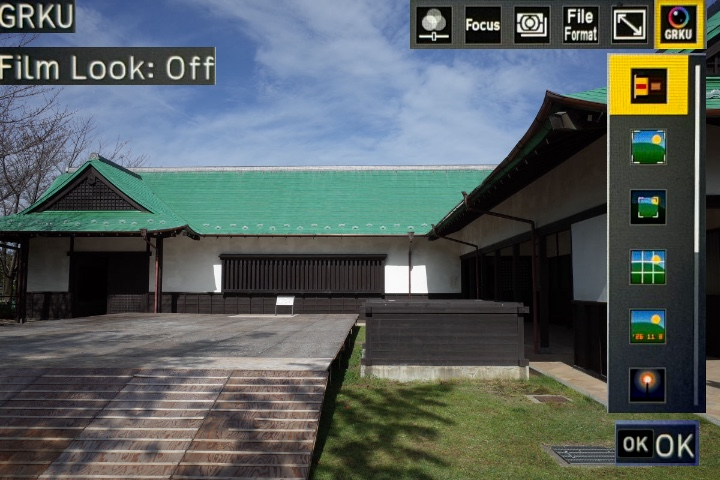
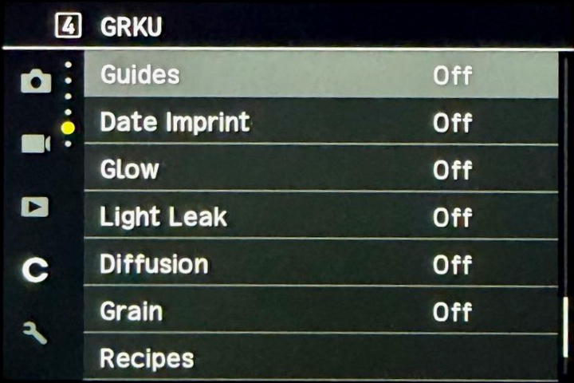

# GRKU.

**GR ของคุณ ในแบบที่ชอบ** — 為 RICOH GR III、GR IIIx 與 GR IV 打造的底片風格，直接從 SD 卡執行。絕不刷入韌體：相機從記憶卡執行腳本，拔出記憶卡，相機就恢復成 Ricoh 出廠時的狀態。

[ไทย](README.th.md) | [English](README.md) | [简体中文](README.zh-Hans.md) | 繁體中文 | [日本語](README.ja.md) | [한국어](README.ko.md)

[](https://github.com/botnick/GRKU/actions/workflows/tests.yml)
[](LICENSE)
[](https://grku.app)

GRKU 是一個獨立專案，由 [BOTNICK](https://github.com/botnick) 先為泰國的 GR 使用者、再為所有人打造而成。它始於 ahonn 的 [GRKit](https://github.com/ahonn/GRKit) 程式碼，GRKit 找到了從 SD 卡在 GR 上執行程式碼的方法，自此之後 GRKU 便被逐步重新建構：包含 145 種風格並附上真實底片盒圖示的底片庫、配方、更多模組、單次啟動、可寫入記憶卡並販售額外風格的網站、泰文語調以及專屬的發布管線。[起源](#origins)小節說明了哪些內容來自 GRKit，以及 GRKU 將其打造成了什麼樣子。

<p>
  
  
</p>

照片：[Mobnoboka](https://commons.wikimedia.org/wiki/File:Oguchi_Joushi_Kouen_1.jpg)，[CC BY-SA 4.0](https://creativecommons.org/licenses/by-sa/4.0/)。

## 功能

拍攝時按下 ADJ 撥桿，選擇第 6 項 GRKU。GRKU 的所有功能都在這裡，以及 MENU 中的 GRKU 小節。

- **底片風格**：145 種真實底片風格，記憶卡中一次可存放 40 種。Kodak、Fujifilm、Ilford、CineStill、Lomography、Polaroid、Agfa、Harman 與 Rollei，再加上 GRKU 仿照 GR II 正片風格自製的 Positive GRII 風格。每種風格都有採用真實底片盒配色的底片盒圖示。按下 Fn 可微調風格；也可以在網站上匯入自己的 LUT。
- **配方**：將整套相機風格命名儲存，或從網站載入熱門配方，即可一次切換底片風格或 Image Control、顆粒、光暈、白平衡、校正與曝光，並支援還原。模式轉盤上的 U1、U2 與 U3 都能存放配方。
- **構圖比例**：XPan、2.35:1、16:9、4:3、5:4、7:6 與 1:1，可裁切 JPEG，也可僅顯示框線。**裁切**：35、40、50、70 或 90 mm，具備即時預覽。
- **輔助線**：三分法、中心、黃金分割、對角線、黃金螺旋、動態對稱。
- **加印日期**：在照片上印日期，有經典、GR1s 點陣或 GR II 三種樣式。
- **光暈**：柔光讓燈光和高光向周圍擴散，底片光暈則呈現電影底片配色的橙紅色光暈。
- **漏光**：暗角、灰塵與毛髮、漏光、刮痕，或褪色、蒙塵、漏光、過期等預設。每張照片的效果分布都不同。
- **柔光**：1/8、1/4 或 1/2 強度的 Black Pro-Mist 濾鏡、陰影處覆上 Black Mist 薄紗感，以及點光源的變形鏡頭光條。
- **顆粒**：四段強度，四種大小。
- **邊框**：白色或黑色的沖印邊框，寬度為照片寬度的 3% 或 6%。
- **開機時啟用**：每次開機時將 GRKU 設為開啟、關閉或維持關機前的狀態。
- **英尺**：記憶卡中放入 `GRKU/FEET.TXT` 後，Snap 對焦距離會以英尺顯示。

開機後 GRKU 需要約 9 秒載入（安裝後的第一次開機會更久）。在這之前相機保持原本的狀態。所有設定都會保留在記憶卡的 `GRKU` 資料夾中。

## 支援機型

| 機型 | 實機測試 | 已支援 |
| --- | --- | --- |
| GR III、GR III HDF | — | 2.10、2.20、2.21 |
| GR IIIx、GR IIIx HDF | — | 1.60、1.70、1.71 |
| GR IV、GR IV HDF | 1.11 | 1.11、1.20、1.21 |
| GR IV Monochrome | — | 1.00、1.10、1.11 |

GRKU 本身的修改已在韌體 1.11 的 GR IV 上執行過。GR III 與 GR IIIx 的安裝包由相同的程式碼和 GRKit 的測試建置，但尚未有人在這些相機上實際執行 GRKU。如果您嘗試了，不論成功與否，請在 [issue](https://github.com/botnick/GRKU/issues) 中告訴我們。

> [!WARNING]
> GRKU 仍是實驗性專案，使用風險請自行承擔。
> 安裝時會開啟相機的 SD 腳本設定，之後需要手動關閉。如果 GRKU 出錯，相機可能卡在開機階段，安裝前請先閱讀[復原指南](resources/RECOVERY.md)。

## 安裝

前往 [grku.app](https://grku.app)，選好你的相機、模組與底片風格，然後選擇其中一種方式：

- 在 Chrome 或 Edge 上**直接寫入 SD 卡**（該網站也可以更新、增減風格以及解除安裝），或
- **下載 ZIP**（`GRKU-gr3.zip`、`GRKU-gr3x.zip` 或 `GRKU-gr4.zip`），並依照壓縮檔內的 PDF 指南操作（[GR III 與 GR IIIx](resources/INSTALLATION.md)、[GR IV](resources/INSTALLATION-GR4.md)）。

只有第一次開機時需要按住 MENU。若要從 ZIP 更新，替換記憶卡中的 `SCRIPT` 資料夾即可；你的設定會保留在 `GRKU` 裡。格式化記憶卡會移除 GRKU。

從 GRKit（GRKU 的源起專案）遷移過來：網站會將你的設定和風格從 `GRKIT` 資料夾移動到 `GRKU`。如果你改用手動複製檔案，請在第一次啟動前將記憶卡根目錄下的 `GRKIT` 重新命名為 `GRKU`，或將其刪除。

如果 GRKU 沒有出現，請在 [issue](https://github.com/botnick/GRKU/issues/new) 中附上 `GRKU/REPORT.TXT`、`GRKU/BOOT.TXT` 和 `SCRIPT/GRKU/INSTALL.ERR`（如果存在）。[每一行的意義說明](docs/diagnostics.md)。

## GRKU Plus

免費版網站可寫入任 10 種風格至記憶卡。GRKU Plus 是一次性以 PromptPay 付費的方案，可解鎖 25 個槽位、品牌包，或全部內容（40 個槽位與所有風格）。金鑰會以電子郵件寄出，可在所有裝置上使用。此服務於 `services/plus` 執行；絕不會存取你的記憶卡。

## 起源

GRKU 源自 GRKit 1.5.2 以及 GRKit 的 `feat/recipes` 分支；執行階段技術、模組 ABI 與測試架構皆來自 GRKit，GRKU 也保留了它們的 MIT 聲明。GRKit 的快速啟動韌體被特意捨棄。以下列出的所有其他內容皆為 GRKU 自身的成果。

| 領域 | GRKit（GRKU 的起點） | 今日的 GRKU | 實現方式 |
| --- | --- | --- | --- |
| 底片庫 | 21 種風格 | 145 種風格，每張卡 40 種；收錄所有風格的底片庫 ZIP | 擬合自 Pat David（CC BY-SA 4.0）、t3mujinpack（MIT）、spektrafilm、Spectral Film LUT 與 Fotufilm 的開放底片預設集，並根據 `docs/popular-films-2026.md` 的 2026 年熱門底片研究選出預設的 40 種 |
| 圖示 | 扁平圖塊 | 每種風格皆有採用真實底片盒配色的底片盒圖示、選單彩色方塊，以及自帶 PNG 圖示的效果 | `scripts/flap-icons.py` 繪製底片盒；效果編譯器接受 `icon: {"png": ...}` |
| 配方 | 未合併的分支 | 已合併，附有對泰文友善的解說、來自 ricohcookbook.com 的熱門配方、三步驟編輯器、範例照片，以及相機風格的設定清單 | `modules/recipes`、`web/src/components/Recipe*.tsx` |
| 模組 | Film Look、Framing、Guides、Date、Glow、Grain | 新增 Crop、Light Leak、Diffusion、Border、Recipes、Enable at Start、英呎標示、黃金螺旋與動態對稱輔助線 | 移植自 MustafaCisse 和 kkasemsa 的分支並全新編寫；一個安裝包可容納十個模組 |
| 啟動 | 每次開機進行多次記憶卡請求 | 一次請求：核心在單一程序中完成掃描、安裝並回報，並將進度傳送至 RAM 中的載入器 | `docs/one-shot-start.md` |
| 快速啟動 | 選用的修補韌體 | 依原則不使用：GRKU 只是記憶卡上的一支腳本 | `docs/fastboot.md` 保留作為記錄 |
| 網站 | 英文、中文、日文、韓文 | 泰文優先、六種語言、以 shadcn/ui 建置的深色單頁安裝程式、六張範例照片的即時預覽、GRKU Plus、SEO 與連結預覽 | `web/`、`services/plus` |
| 記憶卡 | `GRKIT` 資料夾 | `GRKU` 資料夾；網站與 `scripts/card.py` 會移動舊的 `GRKIT` 資料夾，相機絕不接觸它 | `web/src/card.ts`、`scripts/card.py` |
| 品牌 | GRKit | GRKU：帶有紅點的文字標誌、泰文語調、`docs/brand.md` | |
| 發布 | GitHub Actions 至 grkit.app | 同樣的管線用於 grku.app：推送會建立發布 pull request，合併後從官方韌體建置並透過 Cloudflare Pages 部署網站；Plus 服務則從 `services/plus` 部署 | `.github/workflows`、`docs/releasing.md` |

GRKU 保留了 GRKit 的模組 ABI（使用 GRKit SDK 建置的模組仍可載入）及其授權條款，並將適用的修正送回 GRKit。它並非 GRKit 的鏡像：GRKit 後續釋出的版本會經過審視，而非直接合併。

## 從原始碼建置

需要 Rust 1.92 以上版本、支援 ARM 的 Clang 與 LLD，以及理光官方韌體檔案（儲存庫不含韌體）。

```sh
cargo install --path crates/grku-cli --locked
grku effects build --source effects --out build/effects
grku build --target gr4-1.11 --firmware firmware/fwdc248b.bin --out build/runtime
for module in modules/*/; do grku module build --dir "$module" --out "build/modules/$(basename "$module").GRM"; done
sh .github/scripts/install-guide-tools.sh build/guide-tools
sh .github/scripts/build-guides.sh grku build/guide-tools build/guides
grku package --build build/runtime --camera gr4 --effects build/effects-default \
  $(for m in build/modules/*.GRM; do case $m in *BORDER*) ;; *) printf -- '--module %s ' "$m";; esac; done) \
  --guide build/guides/gr4/en.pdf --out dist/GRKU-gr4.zip
grku verify dist/GRKU-gr4.zip
```

`build/effects` 包含全部 145 種風格；一個安裝包最多只能放入 40 種，因此用 `python3 -I scripts/defaults.py build/effects build/effects-default` 選出 `effects/defaults.txt` 的 40 種。一個安裝包可容納十個模組，因此請略過一個（正式發布版略過了 Border）。GR III 請以 `fwdc239b.bin` 建置 `gr3-2.10`，並以 `--camera gr3` 打包。接著以 `python3 -I scripts/card.py write dist/GRKU-gr4.zip` 將安裝包寫入讀卡機中的記憶卡。

## 參與貢獻

請見 [CONTRIBUTING.md](CONTRIBUTING.md)。相機的回報是你能提供最有幫助的內容，特別是來自 GR III 或 GR IIIx 的回報。遇到問題、有想法或疑問，請至 [issues](https://github.com/botnick/GRKU/issues)。

## 文件

- [架構](docs/architecture.md)與[單次啟動](docs/one-shot-start.md)
- [撰寫模組](docs/modules.md)與[模組參考](docs/module-reference.md)
- [裝置回報](docs/diagnostics.md)：`BOOT.TXT`、`REPORT.TXT` 與 `INSTALL.ERR` 逐行說明
- [效果](effects/README.md)、[LUT 來源](docs/lut-sources.md)與 [2026 年熱門底片](docs/popular-films-2026.md)
- [網站](web/README.md)、[品牌規範](docs/brand.md)與[產品筆記](docs/PRODUCT.md)
- [路線圖](docs/roadmap.md)、[社群問卷調查](docs/community-survey.md)與[交接筆記](HANDOFF.md)
- [發布流程](docs/releasing.md)；來自 GRKit、GRKU 未使用的[快速啟動韌體](docs/fastboot.md)

## 授權

程式碼採用 [MIT 授權條款](LICENSE)。GRKU 包含來自 ahonn 的 [GRKit](https://github.com/ahonn/GRKit) 的程式碼，同樣採用 MIT 授權，並保留其聲明。每個安裝包都附有 `LICENSES.md`，列出包內檔案的授權。

- 效果採用 CC BY-SA 4.0、MIT 或 Apache-2.0 授權。詳見 [effects/NOTICE.md](effects/NOTICE.md)。
- 選單與取景畫面的文字使用 [Roboto Condensed](https://github.com/googlefonts/roboto-classic) 字型，採用 [SIL Open Font License 1.1](crates/grku-core/assets/RobotoCondensed-LICENSE.txt)。
- 效果擬合方法移植自 [gr3-film-mods](https://github.com/idontknownihil/gr3-film-mods)，採用 [MIT 授權條款](crates/grku-core/GR3_FILM_MODS_LICENSE.txt)。

RICOH 與 GR 是 Ricoh Company, Ltd. 的商標。底片名稱是各自所有者的商標。GRKU 是由 [BOTNICK](https://github.com/botnick) 發起的獨立專案，與理光、GRKit 作者及任何底片廠商皆無關聯。
