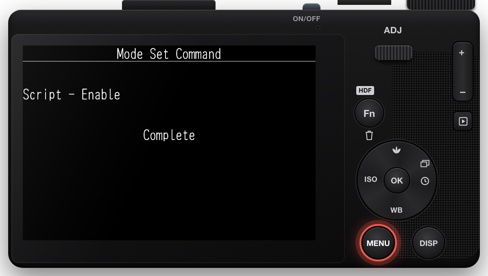
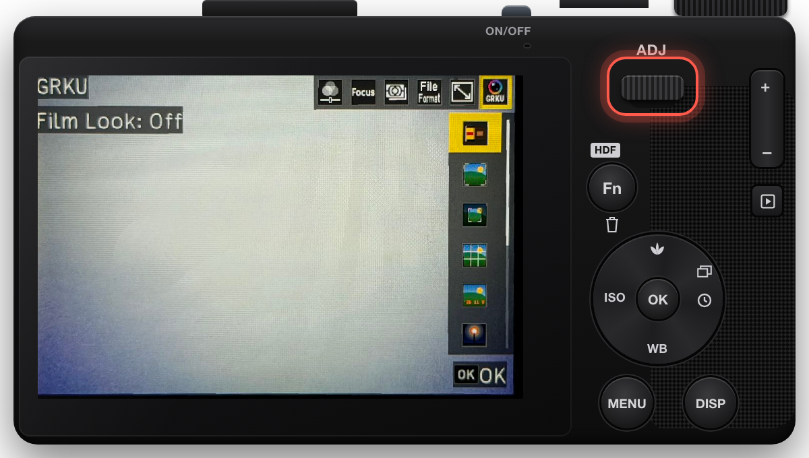

# GRKU

RICOH GR IV 및 GR IV HDF 펌웨어 1.11 전용입니다.

GRKU은 실험적인 소프트웨어이며, 어떠한 보증도 제공하지 않습니다. GRKU에 문제가 생기면 카메라가 시작 중에 멈출 수 있습니다. 설치 전에 [복구 가이드](https://github.com/botnick/GRKU/blob/main/resources/RECOVERY.md)를 읽어 주세요. GRKU을 설치하면 [이용 약관](https://grku.app/terms/)에 동의한 것으로 간주됩니다.

## 설치

컴퓨터의 Chrome 또는 Edge에서 [grku.app](https://grku.app/)을 사용하면 카드 리더기에 있는 카드에 GRKU를 기록할 수 있습니다. 이 방법은 2단계를 대체합니다.

1. 카메라 전원을 끕니다.
2. `SD_ROOT` 폴더 자체가 아니라 그 안의 내용물을 SD 카드의 루트에 복사합니다. 그러면 카드 루트에 `SCRIPT` 폴더가 생깁니다.
3. 카드를 삽입합니다. MENU를 누른 상태에서 카메라 전원을 켭니다. 카메라가 스스로 꺼질 때까지 기다립니다.
4. 카메라 전원을 평소처럼 켭니다.

3단계는 카메라의 SD 스크립트를 활성화합니다. 카메라에 Mode Set Command와 Complete가 표시된 후 카메라가 스스로 꺼집니다. SD 스크립트가 이미 활성화되어 있다면 3단계를 건너뜁니다.

설치가 끝나면 카드 루트에서 `00078560.636`과 `DEVELOP.MOD`를 삭제할 수 있습니다.

## 사용 방법

전원을 켜고 몇 초 뒤 촬영 화면 위쪽에 **GRKU**이 표시되면 불러오기가 끝난 것입니다. 설치나 업데이트 후 처음 켤 때는 조금 더 걸립니다. 불러오기가 끝나기 전에 찍은 사진에는 GRKU 효과가 적용되지 않습니다. 촬영 모드에서 ADJ 레버를 누르고 여섯 번째 항목인 GRKU을 선택합니다.

- **Film Look:** 효과에 커서를 맞추면 라이브 뷰에서 미리 볼 수 있고, OK를 누르면 확정됩니다. Fn을 누르면 그 효과를 조정합니다. 카메라의 Image Control 설정은 바뀌지 않습니다. 효과는 GR III에 맞춰 만들어졌으므로 GR IV에서는 색이 다를 수 있습니다.
- **Framing:** XPan, 2.35:1, 16:9 등의 비율입니다. JPEG 사진을 자르고, DNG 파일은 3:2로 유지됩니다. Fn을 누르면 구도 가이드만 사용하거나 마스크를 설정할 수 있습니다.
- **Guides:** 선은 화면에만 표시되고 사진에는 들어가지 않습니다.
- **Date Imprint:** 사진의 오른쪽 아래에 날짜를 넣습니다. Fn을 누르면 날짜 서식과 글꼴을 선택합니다.
- **Glow:** Bloom과 Halation입니다. JPEG 사진에만 적용되며 라이브 뷰에는 미리 보이지 않습니다.
- **Light Leak:** 비네트, 먼지, 라이트 리크, 스크래치입니다. JPEG 사진에만 적용되며 라이브 뷰에는 미리 보이지 않습니다. Fn을 누르면 각각의 강도를 설정합니다.
- **Diffusion:** Black Pro-Mist 디퓨전 필터의 글로우입니다. JPEG 사진에만 적용되며 라이브 뷰에는 미리 보이지 않습니다. Fn을 누르면 Black Mist(그림자 위의 베일)나 Streak(아나모픽 렌즈의 가로 플레어)를 더합니다.
- **Grain:** 사진에 필름 그레인을 더합니다. Fn을 누르면 그레인 크기를 선택합니다.
- **Border:** 사진 위에 흰색 또는 검은색 가장자리를 넣습니다. 사진 너비의 3% 또는 6%이며, JPEG 사진에만 적용됩니다.

모든 설정은 MENU의 Custom 탭(C) 마지막에 있는 **GRKU** 항목에도 있습니다. 모듈마다 행이 있습니다. 모듈을 켜거나 끄고, **Options**에서 ADJ에 표시할 효과, 비율, 종류를 확인하고, **ADJ Order**에서 순서를 바꿀 수 있습니다. 설정은 전원을 꺼도 유지됩니다.

## 업데이트

컴퓨터의 Chrome이나 Edge에서 [grku.app](https://grku.app/)을 열면 카드 리더에 넣은 카드를 바로 업데이트할 수 있습니다. 2단계와 3단계 대신 사용할 수 있습니다.

1. 카메라의 전원을 끕니다.
2. 카드에서 `SCRIPT` 폴더를 삭제합니다.
3. 새 패키지의 `SD_ROOT`에 있는 `SCRIPT` 폴더를 SD 카드 최상위에 복사합니다.
4. 평소처럼 전원을 켭니다. MENU 버튼을 누를 필요는 없습니다.

GRKU은 설정과 효과를 `GRKU` 폴더에 저장하므로 업데이트 후에도 남습니다.

## 문제 해결

### MENU 버튼을 누른 채 전원을 켜면 펌웨어 업데이트가 시작됩니다

카드 최상위에 펌웨어 파일이 있습니다. 카메라의 전원을 끄고 카드 최상위의 `.bin` 파일을 모두 삭제한 다음, 설치 3단계를 다시 합니다.

### Mode Set Command가 표시되지 않습니다

- MENU 버튼을 누른 채 전원을 켭니다.
- `SD_ROOT`의 내용은 `DCIM` 같은 폴더가 아니라 카드 최상위에 복사합니다.

### ADJ 모드에 GRKU이 표시되지 않습니다

1. 전원을 켜고 촬영 화면 위쪽에 **GRKU**이 표시될 때까지 몇 초 기다립니다.
2. 카드 최상위에 `SCRIPT` 폴더가 있는지 확인합니다.
3. 카드에 `SCRIPT/GRKU/INSTALL.ERR`가 있으면 카메라 메뉴를 열고 지원하는 펌웨어 버전이 표시되는지 확인합니다. 지원한다면 `INSTALL.ERR`, `GRKU/REPORT.TXT`, `GRKU/BOOT.TXT`(있는 경우)를 첨부해 [기기 보고서](https://github.com/botnick/GRKU/issues/new?template=device-report.yml)를 보내 주세요.
4. GRKU은 Ricoh 공식 펌웨어에서만 작동합니다.

### 카드를 포맷한 뒤 GRKU이 작동하지 않습니다

포맷하면 GRKU과 그 설정이 삭제됩니다. 카드를 포맷하기 전에 `GRKU` 폴더를 컴퓨터에 복사합니다. 포맷한 뒤 `SD_ROOT`의 내용을 다시 복사하고, `GRKU` 폴더를 카드 최상위에 다시 복사합니다.

## GRKU 삭제

컴퓨터의 Chrome이나 Edge에서 [grku.app](https://grku.app/)을 열면 카드 리더에 넣은 카드에서 GRKU을 바로 삭제하고, SD 스크립트도 끌 수 있습니다.

카메라의 전원을 끄고 카드에서 `SCRIPT` 폴더와 `GRKU` 폴더를 삭제합니다.

SD 스크립트 설정은 켜진 채로 남습니다. 끄려면:

1. https://grku.app에서 카메라에 맞는 SD 스크립트 끄기 파일을 내려받습니다.
2. `SD_ROOT`의 내용을 SD 카드의 루트에 복사합니다.
3. 카드를 삽입합니다. MENU를 누른 상태에서 카메라 전원을 켭니다. 카메라가 스스로 꺼질 때까지 기다립니다.
4. 카드 루트에서 `00078560.636`과 `DEVELOP.MOD`를 삭제합니다.

카메라가 시작 중에 멈추면 [복구 가이드](https://github.com/botnick/GRKU/blob/main/resources/RECOVERY.md)를 참고하세요.

GRKU은 Ricoh와 관계가 없습니다.
