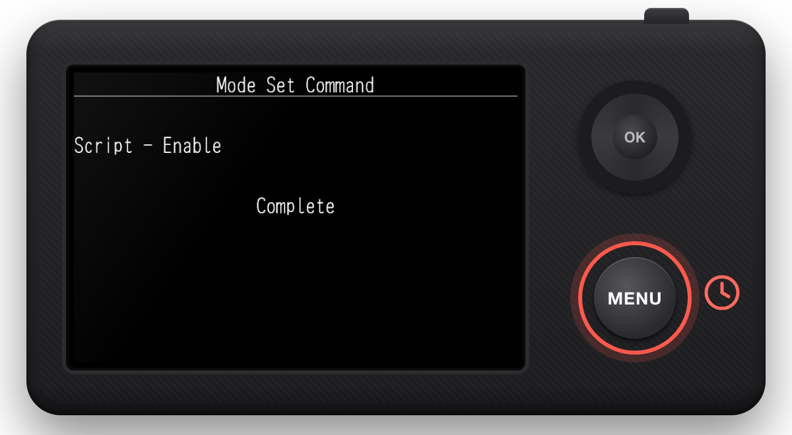

# GRKU

僅適用於 RICOH GR IV 與 GR IV HDF 韌體 1.11。

GRKU 是實驗性軟體，不提供任何擔保。如果 GRKU 出錯，相機可能在啟動時停止回應。請在安裝前閱讀[復原指南](https://github.com/botnick/GRKU/blob/main/resources/RECOVERY.md)。安裝 GRKU 即表示你接受[使用條款](https://grku.app/terms/)。

## 安裝

在電腦上使用 Chrome 或 Edge，[grku.app](https://grku.app/) 可以將 GRKU 寫入讀卡機中的記憶卡。它取代了步驟 2。

1. 關閉相機電源。
2. 將 `SD_ROOT` 的內容（而非資料夾本身）複製到 SD 記憶卡的根目錄。記憶卡根目錄中接著會有 `SCRIPT` 資料夾。
3. 插入記憶卡。按住 MENU 鍵同時開啟相機電源。等待直到相機自行關機。
4. 正常開啟相機電源。

步驟 3 會開啟相機的 SD 腳本：相機會顯示 Mode Set Command 和 Complete，然後自行關機。如果 SD 腳本已經開啟，請跳過步驟 3。

安裝完成後，您可以從記憶卡根目錄中移除 `00078560.636` 和 `DEVELOP.MOD`。

## 使用

開機幾秒後，拍攝畫面頂部顯示 **GRKU**，表示 GRKU 載入完成。安裝或更新後的第一次開機會久一些。在 GRKU 載入完成前拍的照片沒有 GRKU 效果。在拍攝模式下按 ADJ 桿，選擇第 6 項 GRKU。

- **底片風格：** 反白一個效果即可在實時顯示中預覽，按 OK 保留。按 Fn 調整這個效果。不會改變相機的 Image Control 設定。這些效果是為 GR III 製作的，在 GR IV 上顏色可能不同。
- **取景比例：** XPan、2.35:1、16:9 等比例。預設裁切 JPEG 照片，DNG 保持 3:2。按 Fn 可以改為僅輔助構圖，或設定遮罩。
- **輔助線：** 只顯示在螢幕上，不會出現在照片中。
- **日期戳記：** 在照片右下角加印日期。按 Fn 選擇日期樣式和字體。
- **光暈：** Bloom 和 Halation，只套用於 JPEG 照片，拍攝畫面不預覽。
- **漏光：** 暗角、灰塵、漏光和刮痕，只套用於 JPEG 照片，拍攝畫面不預覽。按 Fn 設定各項強度。
- **柔焦：** Black Pro-Mist 柔焦濾鏡的光暈，只套用於 JPEG 照片，拍攝畫面不預覽。按 Fn 加入 Black Mist（陰影上的薄霧）或 Streak（變形鏡頭的水平光斑）。
- **顆粒：** 為照片加上底片顆粒。按 Fn 選擇顆粒大小。
- **邊框：** 在照片上覆蓋白色或黑色邊框，寬度為照片的 3% 或 6%，只套用於 JPEG 照片。

全部設定也在 MENU 自訂頁（C）最後的 **GRKU** 小節中。每個模組一列，可以啟用或關閉模組，在 **Options** 中勾選 ADJ 裡顯示的效果、比例或樣式，在 **ADJ Order** 中調整順序。關機後 GRKU 會保留你的設定。

## 更新

在電腦上的 Chrome 或 Edge 中開啟 [grku.app](https://grku.app/)，可以透過讀卡機直接更新記憶卡，代替第 2、3 步。

1. 關閉相機電源。
2. 從記憶卡刪除 `SCRIPT` 資料夾。
3. 把新安裝包 `SD_ROOT` 中的 `SCRIPT` 資料夾複製到 SD 記憶卡根目錄。
4. 正常開啟相機電源。不需要按住 MENU。

GRKU 的設定和效果保存在 `GRKU` 資料夾中，更新後仍在。

## 疑難排解

### 按住 MENU 開機時，相機開始更新韌體

記憶卡根目錄中有韌體檔案。關閉相機，刪除根目錄中所有 `.bin` 檔案，然後重新執行安裝第 3 步。

### 相機沒有顯示 Mode Set Command

- 先按住 MENU 按鈕，再開機。
- 把 `SD_ROOT` 中的內容複製到記憶卡根目錄，不要複製到 `DCIM` 等資料夾中。

### ADJ 中沒有 GRKU

1. 開機後等待幾秒，直到拍攝畫面頂部顯示 **GRKU**。
2. 確認記憶卡根目錄中有 `SCRIPT` 資料夾。
3. 如果記憶卡中有 `SCRIPT/GRKU/INSTALL.ERR`，在相機選單中確認相機顯示的是支援的韌體版本。版本受支援時，請提交[裝置報告](https://github.com/botnick/GRKU/issues/new?template=device-report.yml)，並附上 `INSTALL.ERR`、`GRKU/REPORT.TXT` 和 `GRKU/BOOT.TXT`（如果有）。
4. GRKU 只能在 Ricoh 官方韌體上運作。

### 格式化記憶卡後 GRKU 不運作

格式化會刪除 GRKU 和它的設定。格式化之前，把 `GRKU` 資料夾複製到電腦。格式化之後，重新複製 `SD_ROOT` 中的內容，再把 `GRKU` 資料夾複製回記憶卡根目錄。

## 移除 GRKU

在電腦上的 Chrome 或 Edge 中開啟 [grku.app](https://grku.app/)，可以透過讀卡機直接移除 GRKU，並可同時關閉 SD 腳本功能。

關閉相機，從記憶卡刪除 `SCRIPT` 和 `GRKU` 資料夾。

SD 腳本功能會保持開啟。要關閉它：

1. 在 https://grku.app 下載你的相機對應的關閉 SD 腳本的檔案。
2. 把 `SD_ROOT` 中的內容複製到 SD 記憶卡的根目錄。
3. 插入記憶卡。按住 MENU 鍵同時開啟相機電源。等待直到相機自行關機。
4. 從記憶卡根目錄刪除 `00078560.636` 與 `DEVELOP.MOD`。

相機在啟動時停止回應時，請參閱[復原指南](https://github.com/botnick/GRKU/blob/main/resources/RECOVERY.md)。

GRKU 與 Ricoh 無關。
