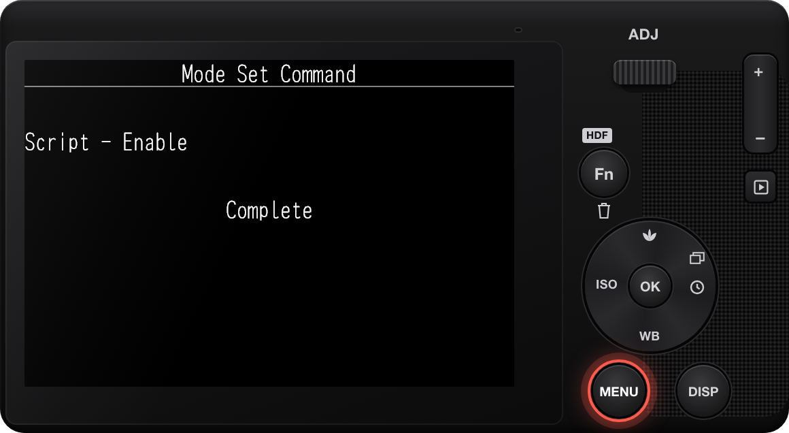
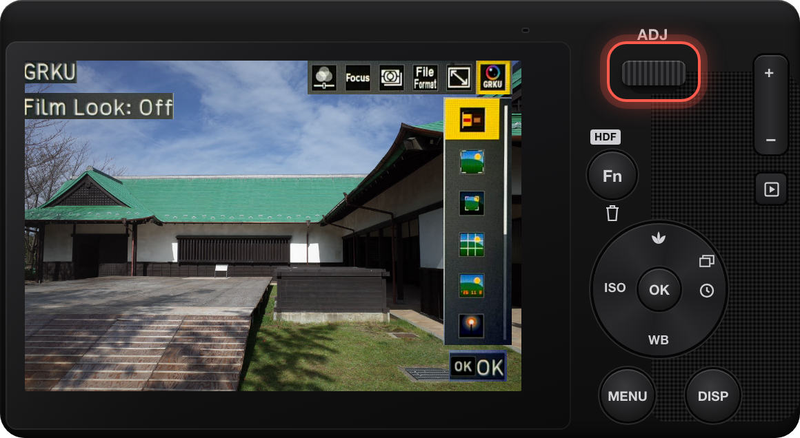

# GRKU

สำหรับ RICOH GR III และ GR III HDF เฟิร์มแวร์ 2.10 เท่านั้น

GRKU เป็นซอฟต์แวร์ทดลองและไม่มีการรับประกันใดๆ หาก GRKU ทำงานผิดพลาด กล้องอาจค้างระหว่างเปิดเครื่องได้ โปรดอ่าน[คู่มือการกู้คืนระบบ](https://github.com/botnick/GRKU/blob/main/resources/RECOVERY.md)ก่อนทำการติดตั้ง เมื่อคุณติดตั้ง GRKU จะถือว่าคุณยอมรับ[ข้อกำหนดการใช้งาน](https://grku.app/terms/)

## การติดตั้ง

เมื่อใช้ Chrome หรือ Edge บนคอมพิวเตอร์ เว็บไซต์ [grku.app](https://grku.app/) สามารถเขียน GRKU ลงในการ์ดผ่านตัวอ่านการ์ดได้ ซึ่งใช้แทนขั้นตอนที่ 2 ได้เลย

1. ปิดกล้อง
2. คัดลอกเนื้อหาทั้งหมดที่อยู่ภายในโฟลเดอร์ `SD_ROOT` (ไม่ใช่คัดลอกทั้งโฟลเดอร์) ไปไว้ที่รูทของการ์ด SD จากนั้นที่รูทของการ์ดจะมีโฟลเดอร์ `SCRIPT` ปรากฏอยู่
3. ใส่การ์ดเข้าไปในกล้อง กดปุ่ม MENU ค้างไว้ขณะเปิดกล้อง รอจนกระทั่งกล้องปิดตัวเองลง
4. เปิดกล้องตามปกติ

ขั้นตอนที่ 3 จะเป็นการเปิดใช้งาน SD script ของกล้อง โดยกล้องจะแสดงข้อความ Mode Set Command และ Complete จากนั้นจะปิดตัวเองลง หากเปิดใช้งาน SD script ไว้อยู่แล้ว ให้ข้ามขั้นตอนที่ 3 ได้เลย

หลังจากการติดตั้งเสร็จสิ้น คุณสามารถลบไฟล์ `00078350.588` และ `DEVELOP.MOD` ออกจากรูทของการ์ดได้

## การใช้งาน

สองสามวินาทีหลังจากเปิดเครื่อง หน้าจอถ่ายภาพจะแสดงคำว่า **GRKU** ที่ด้านบน: แสดงว่า GRKU โหลดเสร็จเรียบร้อยแล้ว การเปิดเครื่องครั้งแรกหลังจากติดตั้งหรืออัปเดตจะใช้เวลานานขึ้น ภาพถ่ายที่ถ่ายก่อนที่ GRKU จะโหลดเสร็จจะไม่มีเอฟเฟกต์ของ GRKU ในโหมดถ่ายภาพ ให้กดคันโยก ADJ แล้วเลือกรายการที่หก GRKU

ภาพถ่าย: [MIKI Yoshihito](https://www.flickr.com/photos/mujitra/53311001084/), [CC BY 2.0](https://creativecommons.org/licenses/by/2.0/)

- **Film Look:** เลื่อนแถบเลือกไปยังเอฟเฟกต์เพื่อดูตัวอย่างในไลฟ์วิว และกด OK เพื่อใช้งาน กด Fn เพื่อปรับแต่งเอฟเฟกต์ โดยจะไม่เปลี่ยนการตั้งค่า Image Control ของกล้อง
- **Framing:** สัดส่วน XPan, 2.35:1, 16:9 และสัดส่วนภาพอื่นๆ ฟังก์ชันนี้จะครอบตัดภาพ JPEG ส่วนไฟล์ DNG จะยังคงเป็น 3:2 กด Fn เพื่อใช้กรอบสำหรับจัดองค์ประกอบภาพเท่านั้น หรือเพื่อตั้งค่ามาสก์
- **Guides:** เส้นนำสายตาบนหน้าจอเท่านั้น ไม่ปรากฏในภาพถ่าย
- **Date Imprint:** วันที่บริเวณมุมขวาล่างของภาพถ่าย กด Fn เพื่อเลือกรูปแบบวันที่และฟอนต์
- **Glow:** เอฟเฟกต์ Bloom และ Halation ใช้ได้กับภาพ JPEG เท่านั้น โดยไม่มีการแสดงตัวอย่างในไลฟ์วิว
- **Light Leak:** ขอบมืด ฝุ่น แสงรั่ว และรอยขีดข่วน ใช้ได้กับภาพ JPEG เท่านั้น โดยไม่มีการแสดงตัวอย่างในไลฟ์วิว กด Fn เพื่อตั้งค่าระดับความเข้มของแต่ละเอฟเฟกต์
- **Diffusion:** แสงฟุ้งนุ่มของฟิลเตอร์ Diffusion แบบ Black Pro-Mist ใช้ได้กับภาพ JPEG เท่านั้น โดยไม่มีการแสดงตัวอย่างในไลฟ์วิว กด Fn เพื่อเพิ่ม Black Mist ฝ้าหมอกบางๆ บนส่วนเงามืด หรือ Streak แสงแฟลร์แนวนอนของเลนส์ Anamorphic
- **Grain:** เกรนฟิล์มบนภาพถ่าย กด Fn เพื่อเลือกขนาดเกรน
- **Border:** ขอบสีขาวหรือสีดำบนภาพถ่าย ขนาด 3% หรือ 6% ของความกว้างภาพ ใช้ได้กับภาพ JPEG เท่านั้น

การตั้งค่าทั้งหมดสามารถเข้าถึงได้จากส่วน **GRKU** ที่ด้านท้ายของแท็บ Customize (C) ใน MENU ด้วยเช่นกัน แต่ละโมดูลจะมีแถวของตัวเอง เปิดหรือปิดโมดูลได้จากที่นั่น ตรวจสอบเอฟเฟกต์ สัดส่วนภาพ หรือรูปแบบที่ ADJ จะแสดงได้ใน **Options** และกำหนดลำดับได้ใน **ADJ Order** ทั้งนี้ GRKU จะยังคงบันทึกการตั้งค่าไว้หลังจากปิดเครื่อง

## การอัปเดต

เมื่อใช้งาน Chrome หรือ Edge บนคอมพิวเตอร์ [grku.app](https://grku.app/) สามารถอัปเดตการ์ดในตัวอ่านการ์ดได้ โดยจะใช้แทนขั้นตอนที่ 2 และ 3

1. ปิดกล้อง
2. ลบโฟลเดอร์ `SCRIPT` ออกจากการ์ด
3. คัดลอกโฟลเดอร์ `SCRIPT` จาก `SD_ROOT` ของแพ็กเกจใหม่ไปยังไดเรกทอรีราก (root) ของการ์ด SD
4. เปิดกล้องตามปกติ ไม่จำเป็นต้องกด MENU ค้างไว้

GRKU จะเก็บการตั้งค่าและเอฟเฟกต์ต่าง ๆ ของคุณไว้ในโฟลเดอร์ `GRKU` ดังนั้นการอัปเดตจึงยังคงค่าเหล่านั้นไว้ทั้งหมด

## การแก้ปัญหา

### กล้องเริ่มการอัปเดตเฟิร์มแวร์เมื่อกด MENU ค้างไว้

มีไฟล์เฟิร์มแวร์อยู่ที่โฟลเดอร์หลักของการ์ด ปิดกล้อง ลบไฟล์ `.bin` ทั้งหมดออกจากโฟลเดอร์หลักของการ์ด แล้วทำขั้นตอนที่ 3 ของการติดตั้งใหม่อีกครั้ง

### กล้องไม่แสดง Mode Set Command

- กด MENU ค้างไว้ แล้วเปิดกล้อง
- คัดลอกข้อมูลภายใน `SD_ROOT` ไปยังโฟลเดอร์หลักของการ์ด ไม่ใช่ใน `DCIM` หรือโฟลเดอร์อื่น

### GRKU ไม่แสดงขึ้นมาใน ADJ

1. รอสักครู่หลังจากเปิดกล้อง จนกระทั่งหน้าจอถ่ายภาพแสดงคำว่า **GRKU** ด้านบน
2. ตรวจสอบให้แน่ใจว่าโฟลเดอร์หลักของการ์ดมีโฟลเดอร์ `SCRIPT`
3. หากในการ์ดมีไฟล์ `SCRIPT/GRKU/INSTALL.ERR` ให้เปิดเมนูกล้องและตรวจสอบให้แน่ใจว่าแพ็กเกจตรงกับเวอร์ชันเฟิร์มแวร์ของกล้อง หากตรงกัน ให้ส่ง [device report](https://github.com/botnick/GRKU/issues/new?template=device-report.yml) พร้อมกับไฟล์ `INSTALL.ERR`, `GRKU/REPORT.TXT` และ `GRKU/BOOT.TXT` หากมีไฟล์นี้อยู่ในการ์ด
4. GRKU ทำงานได้บนเฟิร์มแวร์ทางการของ Ricoh เท่านั้น

### GRKU หยุดทำงานหลังจากฟอร์แมตการ์ด

การฟอร์แมตจะลบ GRKU และการตั้งค่าต่างๆ ก่อนที่จะฟอร์แมตการ์ด ให้คัดลอกโฟลเดอร์ `GRKU` ไปยังคอมพิวเตอร์ หลังจากฟอร์แมตแล้ว ให้คัดลอกข้อมูลภายใน `SD_ROOT` อีกครั้ง จากนั้นคัดลอกโฟลเดอร์ `GRKU` กลับไปยังโฟลเดอร์หลักของการ์ด

## ลบ GRKU ออก

เมื่อเปิดผ่าน Chrome หรือ Edge บนคอมพิวเตอร์ [grku.app](https://grku.app/) สามารถลบ GRKU ออกจากการ์ดที่เสียบอยู่ในเครื่องอ่านการ์ดได้ และยังสามารถปิดการทำงานของ SD script ได้อีกด้วย

ปิดกล้อง จากนั้นลบโฟลเดอร์ `SCRIPT` และ `GRKU` ออกจากการ์ด

การตั้งค่า SD script จะยังคงเปิดอยู่ หากต้องการปิด:

1. เข้าไปที่ https://grku.app แล้วดาวน์โหลดไฟล์สำหรับปิด SD script ที่ตรงกับรุ่นกล้องของคุณ
2. คัดลอกข้อมูลทั้งหมดที่อยู่ใน `SD_ROOT` ไปไว้ที่ไดเรกทอรีราก (root) ของการ์ด SD
3. ใส่การ์ดเข้าไปในกล้อง กดปุ่ม MENU ค้างไว้พร้อมกับเปิดกล้อง รอจนกระทั่งกล้องปิดตัวเองลง
4. ลบไฟล์ `00078350.588` และ `DEVELOP.MOD` ออกจากไดเรกทอรีราก (root) ของการ์ด

หากกล้องค้างระหว่างเปิดเครื่อง สามารถดูวิธีแก้ไขได้ที่ [คู่มือการกู้คืนระบบ](https://github.com/botnick/GRKU/blob/main/resources/RECOVERY.md)

GRKU ไม่มีส่วนเกี่ยวข้องใดๆ กับ Ricoh

Photo in the camera screens: Mobnoboka, CC BY-SA 4.0.
